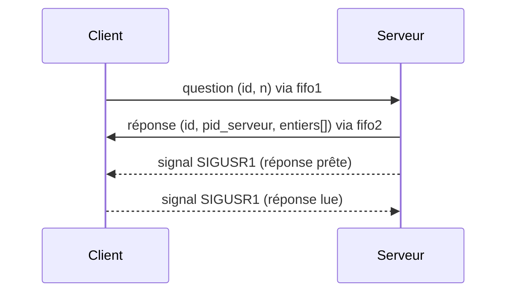

# Rapport de TP : Communication client/serveur par tubes nommés (FIFO)

**Module :** Programmation sous Unix
**Nom et prénom :** ______________________
**Groupe :** ______________________
**Date :** 17/11/2026

---

## 1. Introduction

Ce TP consiste à réaliser un système client/serveur sous Linux. La communication passe par deux tubes nommés (`fifo1` et `fifo2`). La synchronisation passe par le signal `SIGUSR1`.

Le client tire au sort un nombre `n` compris entre 1 et `NMAX` et l'envoie au serveur avec son PID. Le serveur répond avec `n` entiers aléatoires. Les tubes nommés permettent à des processus sans lien de parenté de communiquer, ce qui convient à cette architecture.

## 2. Architecture



| Élément | Rôle |
|---|---|
| `fifo1` | Client vers serveur (questions) |
| `fifo2` | Serveur vers client (réponses) |
| `SIGUSR1` | Le serveur réveille le client quand la réponse est écrite. Le client avertit le serveur quand il l'a lue. |

## 3. Organisation des fichiers

| Fichier | Contenu |
|---|---|
| `serv_cli_fifo.h` | Entêtes système, constantes (`NMAX` = 270, `FIFO1`, `FIFO2`), structures `question` et `reponse` |
| `Handlers_Serv.h` | `hand_reveil` (réveil du serveur) et `fin_serveur` (suppression des tubes avec `unlink`, puis arrêt) |
| `Handlers_Cli.h` | `hand_reveil` (réveil du client) |
| `serveur.c` | Programme du serveur |
| `client.c` | Programme du client |

### Structures de données

```c
struct question { int id; int n; };
struct reponse  { int id; int pid_serveur; int entiers[NMAX]; };
```

## 4. Fonctionnement

**Serveur :**
1. Création de `fifo1` et `fifo2` avec `mkfifo`.
2. Initialisation du générateur aléatoire avec `srand(getpid())`.
3. Ouverture des tubes et installation des handlers (`SIGUSR1`, `SIGINT`).
4. Boucle infinie :
   - lecture d'une question ;
   - construction de la réponse avec `n` entiers aléatoires entre 1 et `NMAX` ;
   - écriture dans `fifo2` ;
   - envoi de `SIGUSR1` au client dont le PID est `q.id`.

**Client :**
1. Ouverture des tubes et installation du handler `SIGUSR1`.
2. Construction de la question : `q.id = getpid()` et `q.n = 1 + rand() % NMAX`.
3. Envoi dans `fifo1`, puis attente avec `pause()`.
4. Lecture de la réponse dans `fifo2` et envoi de `SIGUSR1` au serveur.
5. Affichage des `n` entiers reçus.

## 5. Compilation et exécution

```bash
gcc -w -Iheadres "source files/serveur.c" -o serveur
gcc -w -Iheadres "source files/client.c" -o client
```

Exécution, dans deux terminaux ouverts dans le même dossier :

```bash
./serveur     # terminal 1 (à lancer en premier)
./client      # terminal 2
```

Le serveur s'arrête avec `Ctrl+C`. Le handler `fin_serveur` supprime alors les tubes.

## 6. Tests et résultats

### Test 1 : lancement du serveur

*Commande : `./serveur`*

> **[Insérer la capture d'écran ici]**
>
> &nbsp;
>
> &nbsp;
>
> &nbsp;
>
> &nbsp;

**Commentaire :** ______________________________________________

### Test 2 : exécution d'un client

*Commande : `./client`*

> **[Insérer la capture d'écran ici]**
>
> &nbsp;
>
> &nbsp;
>
> &nbsp;
>
> &nbsp;

**Commentaire :** ______________________________________________

### Test 3 : plusieurs clients successifs ou simultanés

*Commande : `./client` lancé plusieurs fois*

> **[Insérer la capture d'écran ici]**
>
> &nbsp;
>
> &nbsp;
>
> &nbsp;
>
> &nbsp;

**Commentaire :** ______________________________________________

### Test 4 : arrêt du serveur avec Ctrl+C

> **[Insérer la capture d'écran ici]**
>
> &nbsp;
>
> &nbsp;
>
> &nbsp;

**Commentaire :** ______________________________________________

## 7. Conclusion

Ce TP a permis de mettre en pratique les tubes nommés (`mkfifo`, `open`, `read`, `write`, `unlink`) et les signaux (`signal`, `kill`, `pause`). Le serveur et le client communiquent correctement et se synchronisent avec `SIGUSR1`. Le serveur doit être lancé avant le client. Un seul client est traité à la fois, car il n'y a pas de protocole supplémentaire pour distinguer les réponses de plusieurs clients simultanés.
